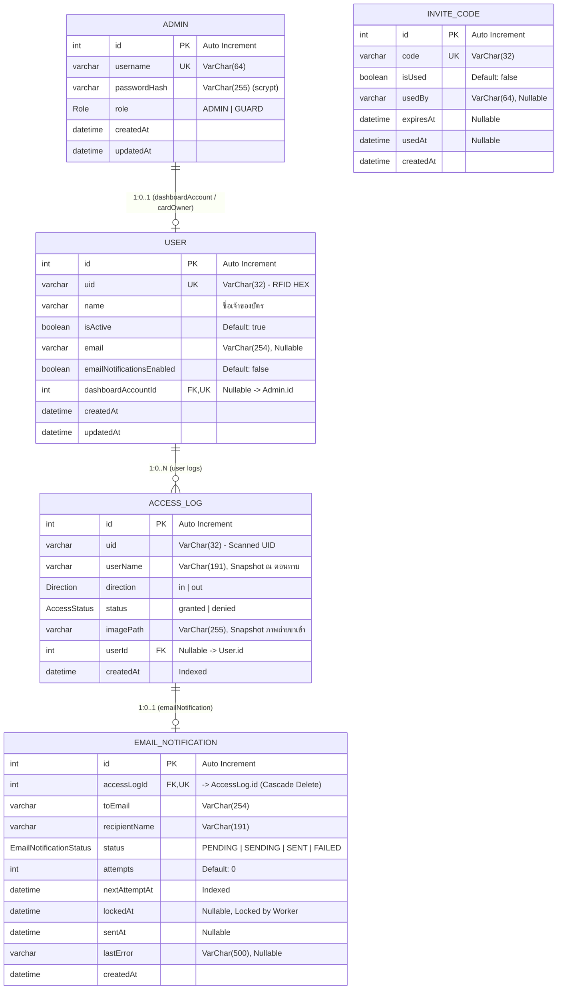

# Entity Relationship Diagram (ER-Diagram)

> **ระบบบันทึกและควบคุมการเข้า-ออกประตูห้องปฏิบัติการ (Security Door Lock / Laboratory Door Access)**  
> **Database:** MySQL (จัดการผ่าน Prisma ORM)

---

## 1. Mermaid ER-Diagram



---

## 2. พจนานุกรมข้อมูล (Data Dictionary)

### 2.1 ตาราง `Admin`
บัญชีผู้ใช้งานสำหรับเข้าสู่ระบบเว็บ Dashboard (แยกจากผู้ถือบัตร RFID)

| ฟิลด์ (Field) | ชนิดข้อมูล (Type) | Key | Nullable | ค่าเริ่มต้น (Default) | คำอธิบาย |
| :--- | :--- | :---: | :---: | :---: | :--- |
| `id` | `INT` | **PK** | No | Auto Increment | รหัสประจำตัวบัญชีผู้ดูแลระบบ |
| `username` | `VARCHAR(64)` | **UK** | No | - | ชื่อผู้ใช้งานสำหรับเข้าสู่ระบบ |
| `passwordHash` | `VARCHAR(255)` | - | No | - | รหัสผ่านที่เข้ารหัสแบบ `scrypt:<salt>:<hash>` |
| `role` | `ENUM('ADMIN','GUARD')` | - | No | `'GUARD'` | สิทธิ์การใช้งานระบบ (`ADMIN` หรือ `GUARD`) |
| `createdAt` | `DATETIME(3)` | - | No | `CURRENT_TIMESTAMP` | วันที่เวลาที่สร้างบัญชี |
| `updatedAt` | `DATETIME(3)` | - | No | - | วันที่เวลาที่แก้ไขข้อมูลล่าสุด |

---

### 2.2 ตาราง `InviteCode`
รหัสเชิญสำหรับให้เจ้าหน้าที่รักษาความปลอดภัย (GUARD) ใช้ลงทะเบียนสร้างบัญชี

| ฟิลด์ (Field) | ชนิดข้อมูล (Type) | Key | Nullable | ค่าเริ่มต้น (Default) | คำอธิบาย |
| :--- | :--- | :---: | :---: | :---: | :--- |
| `id` | `INT` | **PK** | No | Auto Increment | รหัสประจำตัว Invite Code |
| `code` | `VARCHAR(32)` | **UK** | No | - | รหัสเชิญ (Code Token) |
| `isUsed` | `BOOLEAN` | - | No | `FALSE` | สถานะการใช้งาน (ใช้ไปแล้วหรือยัง) |
| `usedBy` | `VARCHAR(64)` | - | Yes | `NULL` | Username ของผู้ที่นำรหัสนี้ไปใช้สมัคร |
| `expiresAt` | `DATETIME(3)` | - | Yes | `NULL` | วันที่และเวลาหมดอายุของรหัสเชิญ |
| `usedAt` | `DATETIME(3)` | - | Yes | `NULL` | วันที่และเวลาที่ถูกนำไปใช้ |
| `createdAt` | `DATETIME(3)` | - | No | `CURRENT_TIMESTAMP` | วันที่และเวลาที่สร้างรหัสเชิญ |

---

### 2.3 ตาราง `User`
ข้อมูลผู้ถือบัตร RFID ที่ได้รับสิทธิ์ผ่านเข้า-ออกประตู (1 คนต่อ 1 บัตร)

| ฟิลด์ (Field) | ชนิดข้อมูล (Type) | Key | Nullable | ค่าเริ่มต้น (Default) | คำอธิบาย |
| :--- | :--- | :---: | :---: | :---: | :--- |
| `id` | `INT` | **PK** | No | Auto Increment | รหัสประจำตัวผู้ถือบัตร |
| `uid` | `VARCHAR(32)` | **UK** | No | - | UID ของบัตร RFID (Hex ตัวพิมพ์ใหญ่ เช่น `"A1B2C3D4"`) |
| `name` | `VARCHAR(191)` | - | No | - | ชื่อ-นามสกุล ของผู้ถือบัตร |
| `isActive` | `BOOLEAN` | - | No | `TRUE` | สถานะการเปิด/ปิด สิทธิ์การผ่านประตู |
| `email` | `VARCHAR(254)` | - | Yes | `NULL` | อีเมลสำหรับรับการแจ้งเตือนเมื่อทาบบัตร |
| `emailNotificationsEnabled`| `BOOLEAN` | - | No | `FALSE` | เปิดรับการแจ้งเตือนทางอีเมลหรือไม่ |
| `dashboardAccountId` | `INT` | **FK, UK** | Yes | `NULL` | อ้างอิงไปยัง `Admin.id` (1-to-1 ความสัมพันธ์แบบไม่บังคับ) |
| `createdAt` | `DATETIME(3)` | - | No | `CURRENT_TIMESTAMP` | วันที่เวลาที่เพิ่มบัตรเข้าสู่ระบบ |
| `updatedAt` | `DATETIME(3)` | - | No | - | วันที่เวลาที่แก้ไขข้อมูลล่าสุด |

---

### 2.4 ตาราง `AccessLog`
ประวัติการทาบบัตรเข้า-ออกประตูทุกครั้ง (รวมถึงกรณีทาบบัตรที่ไม่รู้จักในระบบ)

| ฟิลด์ (Field) | ชนิดข้อมูล (Type) | Key / Index | Nullable | ค่าเริ่มต้น (Default) | คำอธิบาย |
| :--- | :--- | :---: | :---: | :---: | :--- |
| `id` | `INT` | **PK** | No | Auto Increment | รหัสรายการบันทึกการทาบบัตร |
| `uid` | `VARCHAR(32)` | **INDEX** | No | - | UID ของบัตรที่ทาบ (บันทึกซ้ำเพื่อความสมบูรณ์ของ Log) |
| `userName` | `VARCHAR(191)` | - | Yes | `NULL` | Snapshot ชื่อเจ้าของบัตร ณ วินาทีที่ทาบ |
| `direction` | `ENUM('in','out')` | - | No | - | ทิศทางการเข้า-ออก (`in` = ขาเข้า, `out` = ขาออก) |
| `status` | `ENUM('granted','denied')` | - | No | - | ผลการทาบบัตร (`granted` = ผ่าน, `denied` = ไม่อนุญาต) |
| `imagePath` | `VARCHAR(255)` | - | Yes | `NULL` | ที่อยู่ไฟล์ภาพถ่าย snapshot (มีเฉพาะขาเข้า) |
| `userId` | `INT` | **FK, INDEX** | Yes | `NULL` | อ้างอิง `User.id` (เป็น `NULL` หากเป็นบัตรแปลกปลอม) |
| `createdAt` | `DATETIME(3)` | **INDEX** | No | `CURRENT_TIMESTAMP` | วันที่และเวลาที่ทาบบัตร |

---

### 2.5 ตาราง `EmailNotification`
คิวการส่งอีเมลแจ้งเตือนเมื่อเกิดเหตุการณ์ทาบบัตร (Notification Queue/Outbox)

| ฟิลด์ (Field) | ชนิดข้อมูล (Type) | Key / Index | Nullable | ค่าเริ่มต้น (Default) | คำอธิบาย |
| :--- | :--- | :---: | :---: | :---: | :--- |
| `id` | `INT` | **PK** | No | Auto Increment | รหัสคิวการส่งอีเมล |
| `accessLogId` | `INT` | **FK, UK** | No | - | อ้างอิง `AccessLog.id` (1-to-1, ลบตามเมื่อ Log ถูกลบ) |
| `toEmail` | `VARCHAR(254)` | - | No | - | ที่อยู่อีเมลปลายทาง |
| `recipientName` | `VARCHAR(191)` | - | No | - | ชื่อผู้รับการแจ้งเตือน |
| `status` | `ENUM(...)` | **INDEX** | No | `'PENDING'` | สถานะคิว (`PENDING`, `SENDING`, `SENT`, `FAILED`) |
| `attempts` | `INT` | - | No | `0` | จำนวนครั้งที่พยายามส่ง |
| `nextAttemptAt` | `DATETIME(3)` | **INDEX** | No | `CURRENT_TIMESTAMP` | เวลาที่พร้อมส่งในรอบถัดไป |
| `lockedAt` | `DATETIME(3)` | **INDEX** | Yes | `NULL` | เวลาที่ worker กำลังประมวลผล (ป้องกันแย่งงาน) |
| `sentAt` | `DATETIME(3)` | - | Yes | `NULL` | เวลาที่ส่งอีเมลสำเร็จ |
| `lastError` | `VARCHAR(500)` | - | Yes | `NULL` | ข้อความ Error ล่าสุด (กรณีส่งไม่สำเร็จ) |
| `createdAt` | `DATETIME(3)` | - | No | `CURRENT_TIMESTAMP` | เวลาที่สร้างรายการแจ้งเตือน |

---

## 3. รายการ Enumerations

```typescript
// สิทธิ์ของบัญชีบน Dashboard
enum Role {
  ADMIN   // สิทธิ์สูงสุด จัดการบัตร/ผู้ใช้ และออก InviteCode ได้
  GUARD   // ผู้ช่วยดูมอนิเตอร์/Log แต่ไม่สามารถแก้ไขข้อมูลบัตรได้
}

// ทิศทางการผ่านประตู (ตรงกับ Firmware ESP32 และ Frontend)
enum Direction {
  in      // ทาบเข้าห้องปฏิบัติการ
  out     // ทาบออกจากห้องปฏิบัติการ
}

// ผลการอนุญาตเข้า-ออก
enum AccessStatus {
  granted // อนุญาตให้ผ่าน (เปิดกลอนประตู)
  denied  // ปฏิเสธการเข้าถึง (ไม่เปิดกลอนประตู)
}

// สถานะการทำงานของคิวส่งอีเมล
enum EmailNotificationStatus {
  PENDING // รอส่ง
  SENDING // กำลังส่ง (Worker ถือ Lock)
  SENT    // ส่งสำเร็จเรียบร้อย
  FAILED  // ส่งล้มเหลวเกินโควตา
}
```

---

## 4. ความสัมพันธ์และเงื่อนไขการเชื่อมโยง (Relationships & Constraints)

1. **`Admin` ⟷ `User` (1 : 0..1)**
   - เชื่อมต่อผ่าน `User.dashboardAccountId` อ้างอิงไปที่ `Admin.id` (Unique, Nullable)
   - นโยบาย: `ON DELETE SET NULL` — หากบัญชี Admin ถูกลบ บัตรของ User ยังคงใช้งานเปิดประตูได้ตามปกติ
   - ออกแบบแยกตารางกันชัดเจน เพื่อแยกระหว่าง **ผู้มีสิทธิ์เข้า Dashboard** กับ **ผู้ถือบัตรเปิดประตู**

2. **`User` ⟷ `AccessLog` (1 : 0..N)**
   - เชื่อมต่อผ่าน `AccessLog.userId` อ้างอิงไปที่ `User.id` (Nullable)
   - กรณีเป็นบัตรที่ไม่รู้จัก (Unknown Card) ฟิลด์ `userId` จะเป็น `NULL` แต่ยังเก็บบันทึก `uid` ของบัตรไว้
   - มีการทำ **Snapshot `userName`** ไว้ใน `AccessLog` เพื่อให้รายงานย้อนหลังยังคงแสดงชื่อเดิมได้ แม้ว่าในอนาคต `User` จะเปลี่ยนชื่อหรือถูกลบออกจากระบบ

3. **`AccessLog` ⟷ `EmailNotification` (1 : 0..1)**
   - เชื่อมต่อผ่าน `EmailNotification.accessLogId` อ้างอิงไปที่ `AccessLog.id` (Unique, Not Null)
   - นโยบาย: `ON DELETE CASCADE` — เมื่อลบประวัติการเข้า-ออก คิวแจ้งเตือนที่เกี่ยวข้องจะถูกลบตามโดยอัตโนมัติ

4. **`InviteCode` (ตารางอิสระ)**
   - ทำหน้าที่เป็น token ยืนยันสิทธิ์สำหรับลงทะเบียน `Admin` ที่มี role เป็น `GUARD` (ไม่มี Foreign Key ผูกตรง เพื่อความยืดหยุ่นและการเก็บ audit log ผ่าน `usedBy`)
